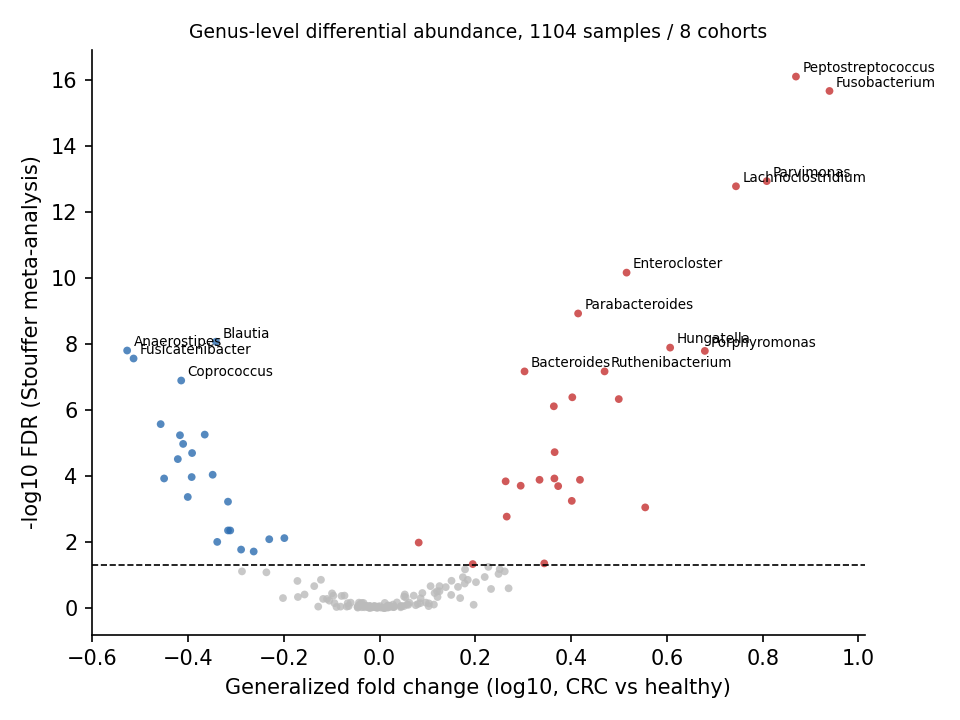
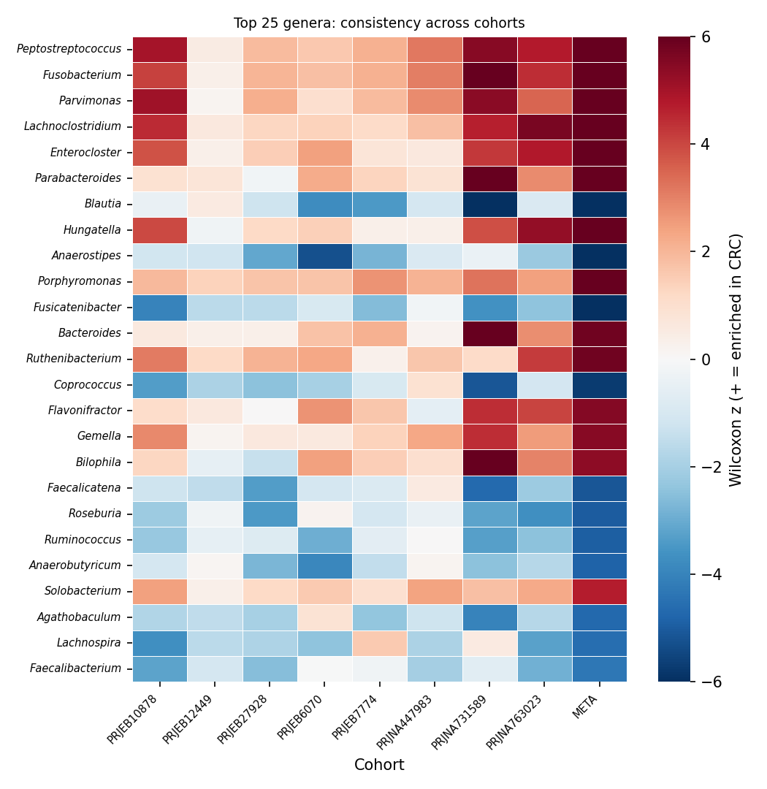
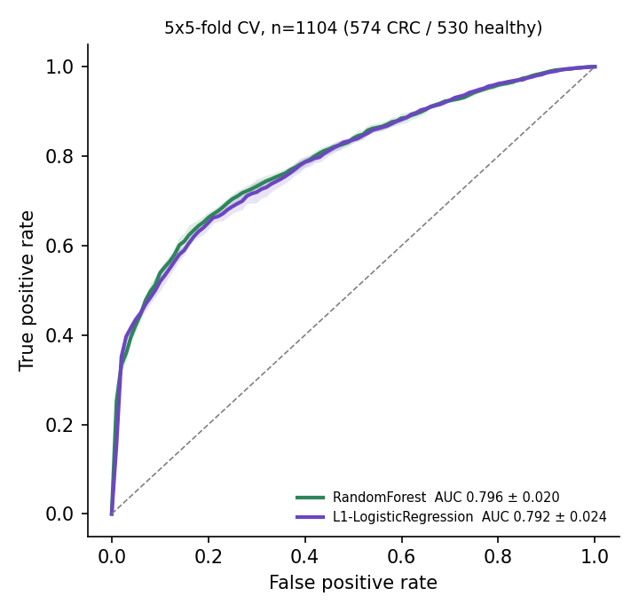
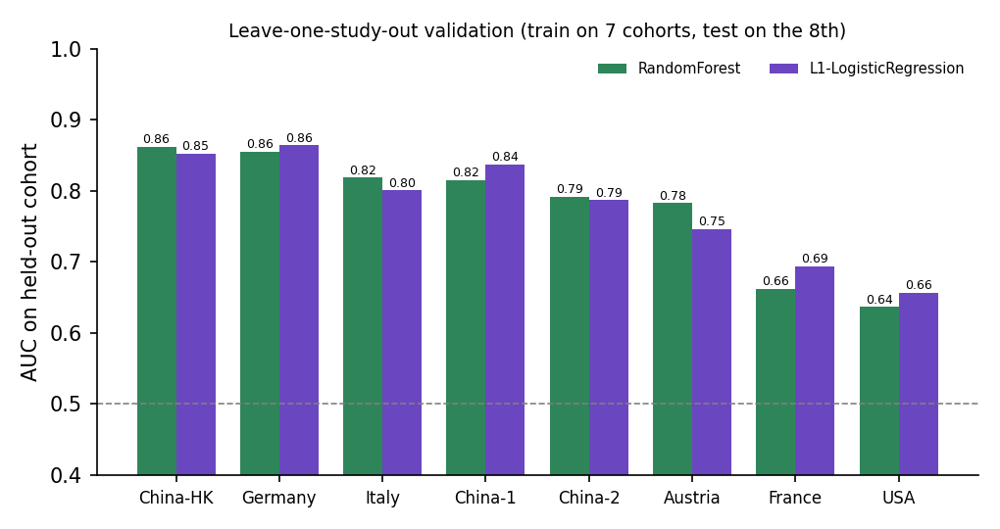
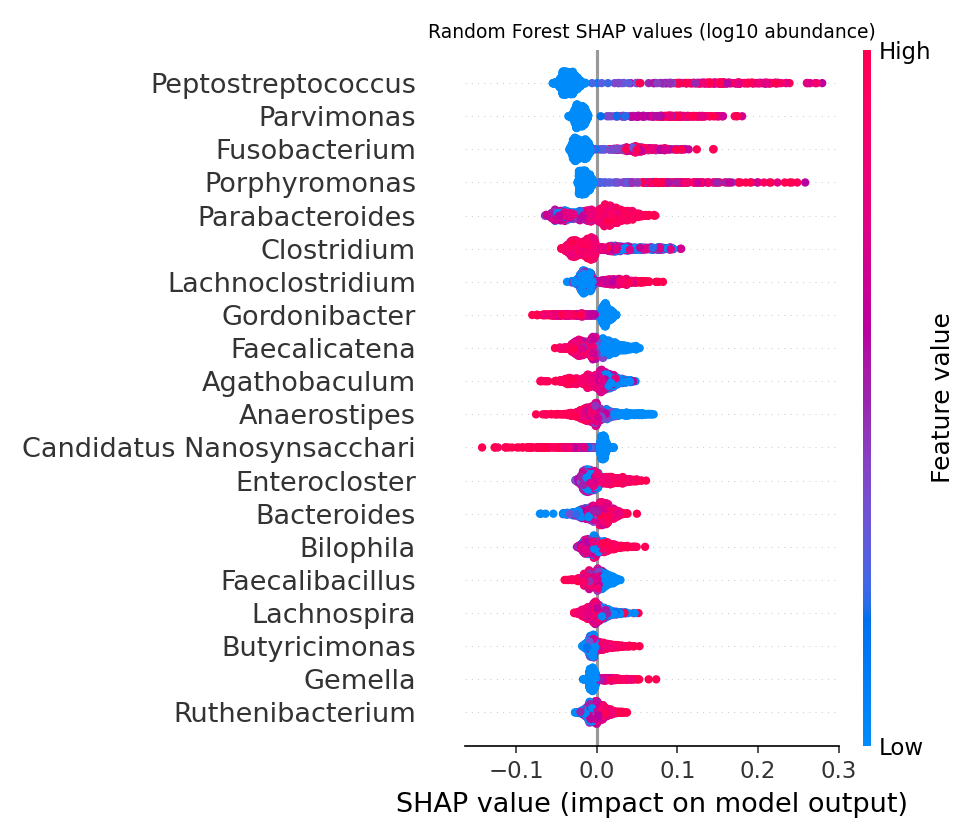

# Gut microbiome biomarkers for colorectal cancer: a multi-cohort meta-analysis

[](https://github.com/Swetcha2001/crc-microbiome-biomarkers/actions/workflows/ci.yml)


This project identifies gut bacterial genera associated with colorectal cancer, using **1,104 shotgun-metagenomic stool samples from 8 international cohorts** curated in [GMrepo](https://gmrepo.humangut.info). It then asks how well those microbes can classify patients **in a cohort the model has never seen**.

| | |
|---|---|
| **Samples** | 1,104 (574 colorectal neoplasm, 530 healthy), one run per sample, GMrepo QC-passed |
| **Cohorts** | France, Austria, Germany, Italy, USA, 3x China (Hong Kong + 2 mainland) |
| **Features** | 169 bacterial genera (≥5% prevalence, re-normalised after removing unclassified reads) |
| **Statistics** | Per-cohort Wilcoxon rank-sum → sample-size-weighted Stouffer meta-analysis → BH FDR |
| **Models** | Random Forest and L1 logistic regression, with feature selection **nested inside CV folds** |
| **Validation** | 5×5-fold stratified CV and **leave-one-study-out (LOSO)** cross-cohort validation |
| **Interpretation** | SHAP values, generalized fold change, per-cohort effect consistency |

## Key results

### 1. 48 genera differ significantly (FDR < 0.05); 26 enriched and 22 depleted in CRC



The strongest signals are the well-described **oral-pathobiont CRC signature**. Each of these is enriched in CRC in all 8 cohorts:

| Genus | Meta z | FDR | Prevalence CRC vs healthy |
|---|---:|---:|---|
| *Peptostreptococcus* | 8.92 | 8.1e-17 | 34% vs 4% |
| *Fusobacterium* | 8.73 | 2.2e-16 | 43% vs 13% |
| *Parvimonas* | 7.94 | 1.2e-13 | 32% vs 5% |
| *Porphyromonas* | 6.11 | 1.6e-08 | enriched in 8/8 cohorts |
| *Gemella* | 5.47 | 4.7e-07 | enriched in 8/8 cohorts |

Depleted in CRC: butyrate producers such as *Anaerostipes*, *Fusicatenibacter*, *Blautia*, *Coprococcus*, *Roseburia* and *Ruminococcus*. These are consistent with loss of short-chain-fatty-acid–producing commensals.



### 2. Classification performance

| Model | 5×5-fold CV AUC | LOSO AUC (mean) | LOSO range |
|---|---:|---:|---|
| Random Forest (top-40 genera) | **0.796 ± 0.020** | **0.778** | 0.64 – 0.86 |
| L1 logistic regression | 0.792 ± 0.024 | 0.780 | 0.66 – 0.86 |

 

Models trained on seven cohorts transfer to the eighth with AUC 0.75–0.86 in six of eight cohorts. The **France and USA cohorts are hardest (AUC 0.64–0.69)**. Plausible reasons are cohort composition, since MeSH "Colorectal Neoplasms" can include adenomas in some studies, and sequencing and geography batch effects. That is why pooled CV alone overstates real-world performance.

### 3. What drives the model: SHAP



High abundance of *Peptostreptococcus*, *Parvimonas*, *Fusobacterium* and *Porphyromonas* pushes predictions toward CRC. Butyrate producers push toward healthy. The model learns biology that matches the univariate meta-analysis.

## Methods

1. **Data** (`scripts/01_download_gmrepo.py`): GMrepo REST API. Runs are annotated with MeSH D015179 (Colorectal Neoplasms) or D006262 (Health), `experiment_type = Metagenomics`, `QCStatus = 1`. Only cohorts containing both groups are kept, with one run per `sample_id`. GMrepo provides uniformly re-processed taxonomic profiles, so cohorts are comparable.
2. **Matrix** (`02_build_matrix.py`): genus relative abundances. The "Unknown" fraction is removed and profiles are re-scaled to 100%. Genera present in <5% of samples are dropped.
3. **Differential abundance** (`03_differential_abundance.py`): a two-sided Mann–Whitney U test within each cohort, converted to signed z. The z values are combined with Stouffer's method weighted by √n, then Benjamini–Hochberg FDR is applied. Effect size is the generalized fold change (mean log10 quantile difference, Wirbel et al. 2019), which is robust to zero inflation.
4. **Classification** (`04_classify.py`): log10(abundance + 1e-4). A custom `WilcoxonSelector` (top k = 40 genera) is part of the scikit-learn `Pipeline`, so feature selection is refit on every training fold and never sees test samples. The Random Forest uses 500 trees, balanced class weights and min_samples_leaf 2. LOSO validation retrains the full pipeline without the held-out cohort.
5. **Tests**: `pytest` unit tests check signal recovery on simulated data, selector behaviour and LOSO. CI re-runs the full analysis from the committed raw profiles on every push.

## Reproduce

```bash
git clone https://github.com/Swetcha2001/crc-microbiome-biomarkers.git
cd crc-microbiome-biomarkers
pip install -r requirements.txt
make all      # matrix -> differential abundance -> classification (~2 min)
make test
# optional: make download   (re-fetch everything from GMrepo)
```

## Repository layout

```
src/crcmb/            data loading, statistics (Wilcoxon/Stouffer/gFC), models (nested CV, LOSO)
scripts/01-04_*.py    numbered, re-runnable analysis steps
data/raw/             GMrepo sample sheet + per-run genus profiles (JSON)
data/processed/       genus x sample matrix, metadata
results/tables/       differential_abundance.tsv, loso_validation.tsv, rf_feature_importance.tsv, model_summary.json
results/figures/      volcano, cohort heatmap, ROC, LOSO, SHAP
tests/                pytest unit tests
```

## Limitations

- Genus-level only. GMrepo provides species-level profiles for only a subset of these cohorts, so genus is the common denominator.
- Case labels follow GMrepo's MeSH annotation (Colorectal Neoplasms), which may include advanced adenomas in some cohorts.
- Stool microbiome signatures are screening aids, not diagnostics. Clinical use would require prospective validation against colonoscopy/FIT.

## References

- Dai S. et al. *GMrepo v2*. Nucleic Acids Res (2022)
- Wirbel J. et al. Meta-analysis of fecal metagenomes reveals global microbial signatures specific for colorectal cancer. *Nat Med* 25, 679–689 (2019)
- Thomas A.M. et al. Metagenomic analysis of colorectal cancer datasets identifies cross-cohort microbial diagnostic signatures. *Nat Med* 25, 667–678 (2019)

## Author

**Swetcha Radandi**, Bioinformatics / Molecular Genetics · [GitHub](https://github.com/Swetcha2001)
